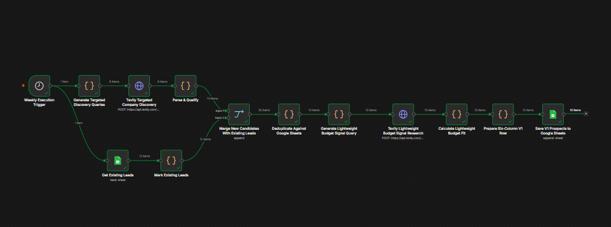
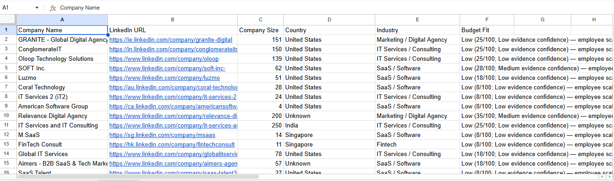

# Automated Prospect Discovery & Qualification Pipeline

An automated, end-to-end n8n workflow designed to discover, extract, deduplicate, and score B2B leads using Tavily search queries and Google Sheets. 

This workflow targets mid-sized companies across key global markets (USA, Europe, Asia, and UAE), checks incoming prospects against existing sheet records to prevent duplicate entries, performs background web research for budget/growth indicators, and appends fully scored leads to your CRM or database.

---

## 📷 Screenshots & Visual Overview

### Workflow Architecture


### Sample Output (Google Sheets Integration)


---

## 🌟 Key Features

* **Scheduled Execution:** Triggers automatically on a weekly schedule (Mondays at 8:00 AM).
* **Multi-Region Targeted Search:** Automatically builds Boolean search queries tailored to company sizes (11–200 employees) and specific verticals (SaaS, IT Services, Digital Agencies, Fintech) across USA, Europe, Asia, and UAE.
* **Tavily Web Scraping & Enrichment:** Leverages the Tavily Search API to perform initial discovery and deep-dive signal research.
* **Smart Qualification & Extraction:** Custom JavaScript nodes parse raw search snippets to extract clean company names, LinkedIn URLs/slugs, estimated employee counts, primary industries, and headquarters countries.
* **Two-Layer Deduplication:** Matches prospective candidates against existing Google Sheets records using normalized company names and unique LinkedIn slugs.
* **Automated Budget Fit Scoring:** Analyzes secondary research signals (revenue estimates, operating history/founding year, hiring activity, and expansion news) to assign a weighted **Budget Fit Score** (0–100) and confidence rating.
* **Google Sheets Integration:** Automatically appends qualified six-column lead records into your targeted sheet.

---

## ⚙️ Workflow Steps

```
[Weekly Schedule Trigger]
     ├──> [Generate Queries] ──> [Tavily Discovery] ──> [Parse & Qualify] ──┐
     │                                                                     │
     └──> [Get Existing Leads] ──> [Mark Existing] ────────────────────────┴──> [Merge Leads]
                                                                                   │
                                                                       [Deduplicate vs Sheets]
                                                                                   │
                                                                     [Generate Budget Queries]
                                                                                   │
                                                                     [Tavily Signal Research]
                                                                                   │
                                                                     [Calculate Budget Score]
                                                                                   │
                                                                     [Prepare 6-Column Row]
                                                                                   │
                                                                   [Append to Google Sheets]
```

---

## 🚀 Prerequisites

Before importing and activating this workflow, ensure you have:

1. **n8n Instance:** Self-hosted (Docker) or n8n Cloud instance running version 1.0+.
2. **Tavily API Key:** An active API key from [Tavily AI](https://tavily.com/).
3. **Google Sheets OAuth Credentials:** Authenticated access to Google Sheets via n8n.
4. **Target Google Sheet:** A spreadsheet set up with the following exact header row:
   * `Company Name`
   * `LinkedIn URL`
   * `Company Size`
   * `Country`
   * `Industry`
   * `Budget Fit`

---

## 🛠️ Setup & Installation Instructions

### 1. Import Workflow
1. Download the `Prospect Discovery Pipeline.json` file from this repository.
2. Open your n8n canvas dashboard.
3. Click **Import from File** in the top-right menu and select the JSON file.

### 2. Configure Credentials
Update the node credentials inside n8n:
* **Tavily Nodes:** Update both `Tavily Targeted Company Discovery` and `Tavily Lightweight Budget Signal Research` with your actual Tavily API credentials.
* **Google Sheets Nodes:** Set your `googleSheetsOAuth2Api` credential on both the `Get Existing Leads` and `Save V1 Prospects to Google Sheets` nodes.

### 3. Set Google Sheet File & Sheet IDs
In both Google Sheets nodes:
1. Replace `YOUR_CREDENTIALS_HERE` in the `Document ID` field with your spreadsheet's unique ID (found in your Google Sheet URL: `https://docs.google.com/spreadsheets/d/YOUR_DOCUMENT_ID/edit`).
2. Verify the sheet/tab selection matches your target tab name/GID.

### 4. Enable Workflow
Toggle the workflow status from **Inactive** to **Active** in the top toolbar.

---

## 📊 Budget Fit Scoring Logic

The workflow scores lead quality on a 0–100 scale using the following factors:

* **Employee Count Scale:** 8 to 25 points based on team size brackets.
* **Credible Revenue Signals:** 6 to 30 points (verified via sources like Crunchbase, Forbes, Latka, ZoomInfo, etc.).
* **Company Operating History:** 3 to 15 points based on years in business.
* **Hiring Activity:** +5 points for general job listings, +10 points for aggressive hiring pushes.
* **Expansion / Growth:** +10 points for recent funding rounds or new office openings.

**Final Ratings:**
* **High:** 65+ points
* **Medium:** 40–64 points
* **Low:** Under 40 points

---

## 🗺️ Roadmap / Upcoming V2 Enhancements

The next major iteration (V2) of this pipeline will introduce:
* **Upgraded Budget Signal Research & Scoring:** Enhanced web search heuristics and multi-source financial signal cross-referencing to calculate higher-precision budget scores.
* **Improved Parsing & Qualification Layer:** Refined extraction algorithms to significantly increase company size estimation accuracy and eliminate ambiguity around employee headcounts vs. client/user counts.
* **LLM-Based Data Extraction:** Native integration with LLM parsing for handling complex, non-standard web page structures.

---

## 🔒 Security & Privacy Note

The JSON workflow template in this repository contains **no hardcoded credentials, secret keys, or sensitive API tokens**. All authentication parameters use standard n8n credential placeholders.